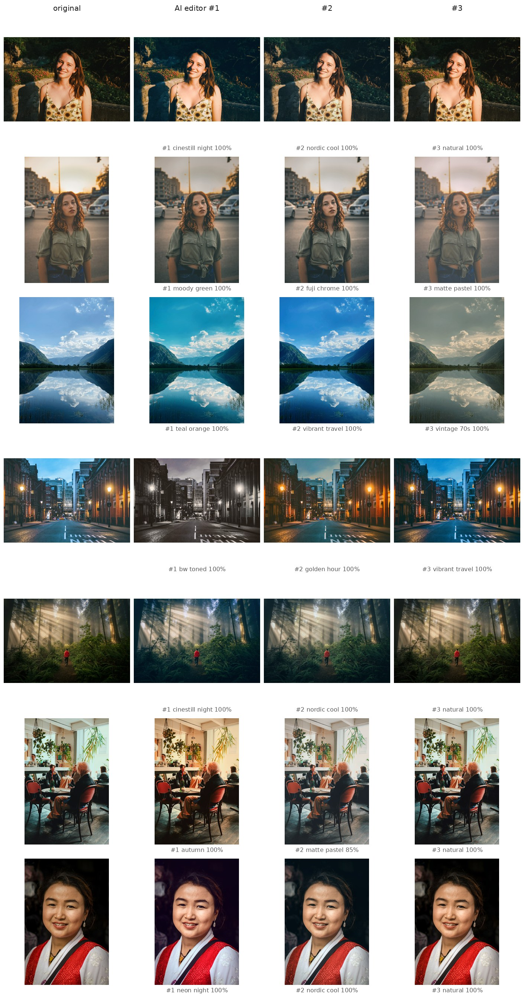
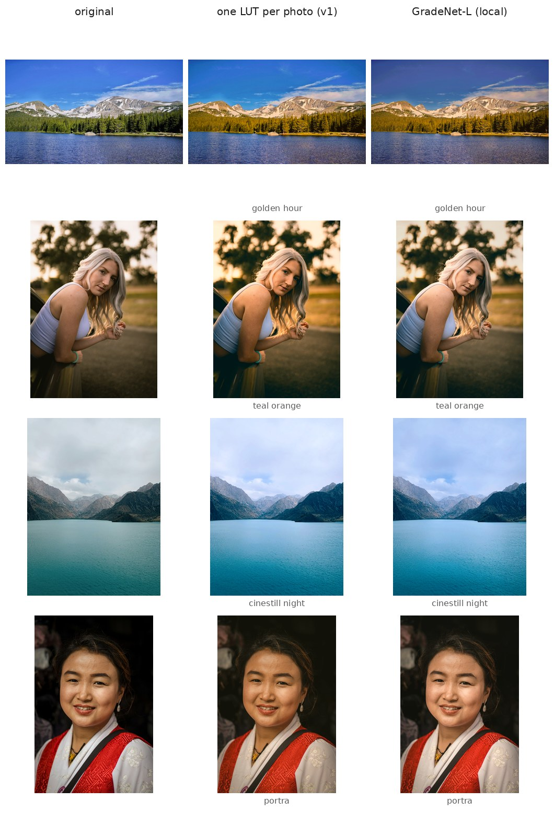
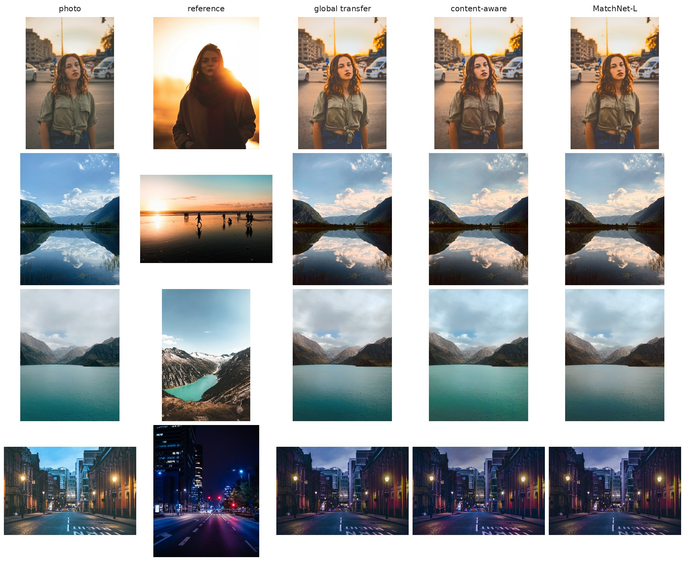

# GradeStudio ML — on-device AI color grading

The machine-learning engine behind **Grade Studio**: models that look at a photo, fix it, and color grade it the way a colorist would, **region by region**, small enough to run on an iPhone.

- **AI editor.** Corrects exposure, white balance and contrast, then grades the photo in one of 14 looks (golden hour, teal & orange, Portra, Cinestill, B&W, …). Sky, people, skin, foreground and distance each get their own treatment. The editor proposes its **top 3** versions and explains why.
- **Local, edge-aware grading without masks on device.** The model predicts 4 color LUTs plus a bilateral grid that decides, per pixel, how to blend them. The blend follows the photo's own edges, so no segmentation model runs on the phone.
- **Natural skin under every look.** The model is trained on 25k Unsplash + 22.7k Open Images photos, with skin-aware targets. It is evaluated per skin tone.
- **Match a reference photo by content.** Sky matches sky, skin matches skin, foliage matches foliage, instead of one global color shift. The repo has a DINOv2-based matcher and a 7.5M-parameter on-device distillation of it.
- **Ships as Core ML.** The model predicts at 256 px and the result is applied to the full-resolution photo in Core Image / Metal. Exports are 13–15 MB fp16 with only standard ops.


<sub>Original, then the editor's top 3 choices (GradeNet-L v4). None of these photos were in the training data. Photo credits: [docs/images/CREDITS.md](docs/images/CREDITS.md).</sub>

## Results at a glance

All numbers are on held-out photos the models never trained on. PSNR (dB) is measured against the finished, graded target (higher is better). Skin hue error (degrees) is how far skin color drifts from the target (lower is better).

| | all photos | sky | skin (people photos) | skin hue error |
|---|---|---|---|---|
| fixed preset (same LUT for every photo) | 25.41 | – | – | – |
| GradeNet v1: one LUT per photo | 25.77 | 22.03 | 22.85 | 10.1° |
| **GradeNet-L v4: local grading** | **27.60** | **26.97** | **26.71** | **5.9°** |

The skin columns use 431 Open Images people photos. The editor ranking fix cut B&W/bleach-bypass picks from 23% to 2%, and now all 15 looks can win. Reference matching: MatchNet-L reaches 34.7 dB against its teacher, vs 33.3 dB for a global color transfer. Details and caveats are below.


<sub>The same look applied by one LUT per photo (middle) and by GradeNet-L (right). The local model handles the sky separately (first row) and keeps skin closer to natural.</sub>

---

## How it works

### 1. GradeNet-L: K LUTs blended by a bilateral grid

```
photo 256px ─► conv stem ─► 16×16 features ──────────┐ (+ global, fused)
     │                    └► 4×4 → pooled ─┐         ▼
     └► color statistics ─────────────────►├► MLP ─► 4 × LUT weights ─► 4 LUTs (33³) = identity + w·basis
style one-hot ─► embedding ───────────────►┘         └► grid head ─► bilateral grid (4 × 8 luma × 16 × 16)

full-res pixel p:  weights = softmax_k( grid[x, y, luma(p)] )      out = Σ_k weights_k · LUT_k(p)
```

- **Why LUTs.** A 3D LUT is a color → color function. Applying it to a 48 MP photo is one texture lookup per pixel (`CIColorCube`), so the network only ever sees 256 px.
- **Why a bilateral grid.** Indexing the blend weights by the pixel's *own luminance*, as well as its position, is HDRNet-style slicing (Gharbi et al. 2017). A bright sky and a dark ridge in the same grid cell can therefore take different LUTs, with no halo and no segmentation model.
- **Building blocks.** The LUT bank is residual (identity + learned bases; Zeng et al. 2020). Explicit color statistics are fed to the head because instance norm erases color casts. Regularizers keep the LUTs smooth and monotone and the grid smooth.
- **On device.** The cost is 4 `CIColorCube` passes plus one small Core Image kernel. `grademl.local.slice_packed` is the reference implementation of the packed-grid lookup, and a test checks it against training.

Code: `src/grademl/local.py`.

### 2. Training data: faults in, a colorist's finish out

There are no paired before/after datasets that can be used commercially, so the training pairs are built:

- **Input:** a finished photo (Unsplash or Open Images) with random faults added:
  - **global:** exposure, white balance, contrast, saturation, flat camera profile;
  - **local:** a bright sky over dark ground, a backlit subject, graduated light fall-off, a color cast on the subject only (foliage bounce, open shade, mixed light).
- **Target:** the finished photo, graded in the requested look with **local finishing** (`grademl.local_looks`):
  - **sky:** density and color in the look's own palette, applied before the look so B&W gets a red-filter sky;
  - **people:** a gentler look, light on the subject, a calmer background;
  - **skin:** natural hue and chroma under every look. Skin moves halfway back to the photo's skin, then toward the "skin line", plus a little light on faces;
  - **depth:** aerial perspective, so distant parts get softer contrast in the look's "air" tint;
  - **vignette**, held off the highlights.
- **Masks for building targets.** The masks a colorist would draw come from **OneFormer** (sky, people, plants, water, buildings) and depth from **Depth Anything V2**. They are computed once (`scripts/label_scenes.py`) and are only used to build targets. The trained model never sees them; it learns where the sky and the people are from the photo itself.
- **What the looks mean** comes from colorist recipes (`grademl.pro_looks`): hue-selective HSL, hue-qualified color wheels and filmic tone. **How to apply them to a given photo** is what the model learns.

### 3. People and skin

People are only about 10% of Unsplash, so three things are done:

- **More people photos.** 30k photos from **Open Images** were added (CC BY 2.0; person box ≥ 10% of the frame; drawings and depictions excluded). A quality filter (`scripts/filter_quality.py`) keeps 22.7k: it drops black-and-white photos and photos the model's own critic finds far from finished.
- **Oversampling.** About 39% of training samples contain a person, and half of their crops are centered on the person.
- **Weighted loss.** Errors count ×4 on people and ×6 on skin.
- **Per-skin-tone evaluation.** Results are split by ITA angle (light > 41°, medium 10–41°, dark < 10°).

### 4. The editor: every look, judged, top 3

`grademl.editor` grades the photo in all 14 looks at 60/85/100% intensity, then scores each candidate:

- **critic:** the same network with style "none" estimates how much it would still correct the candidate (less = reads as finished);
- **bold:** a bonus for a visible grade;
- **fit:** a scene-fit prior;
- **penalties** for clipping, for skin pushed off its color, and for draining a colorful photo.

The critic and boldness terms are **calibrated per look** against their average over held-out photos. Without that, looks that always change a lot, or that remove what the critic would correct (B&W has no color left to fix), win on every photo. The top 3 come from different look families: warm, film, cool, mono, stylized, soft, natural.

### 5. Matching a reference photo by content

`grademl.semantic_match`:

1. **DINOv2** (ViT-S/14) patch features of both images are compared.
2. The photo is split into regions in feature space.
3. Each region finds the same *kind of thing* in the reference.
4. Color transfers per region (luminance curve, per-band tint, chroma spread). Tone stays mostly global, because per-region tone curves leave visible seams.

**MatchNet-L** (`grademl.local.MatchLocalNet`) distills this into a phone-sized network:

- Both images go through a shared conv stem. Each photo cell **cross-attends** to the reference cells (features + cell colors), and the result drives the same LUTs-plus-grid output as GradeNet-L.
- It is **residual on the global color transfer**, so it only has to learn the region-by-region part.
- Training uses 49k pairs: mostly content neighbours by DINOv2 similarity, with the reference pushed through a random pro look. The teacher outputs are precomputed (`scripts/make_match_pairs.py`).


<sub>The content-aware match moves the lake toward the reference's turquoise and gives the road the reference road's purple glow, where the global transfer tints everything alike. MatchNet-L (right) reproduces part of that on device.</sub>

---

## Detailed results

### Local grading (held-out Unsplash, faulty inputs, same targets for every model)

| | all photos | sky | people photos | person | skin | skin hue |
|---|---|---|---|---|---|---|
| fixed preset | 25.41 | | 25.31 | | | |
| GradeNet v1 (one LUT) | 25.77 | 22.03 | 25.61 | 26.43 | 22.44 | 9.2° |
| GradeNet-L v1 | **27.80** | 27.07 | 27.23 | 26.51 | 22.98 | 9.8° |
| GradeNet-L v2 (people ×5) | 27.50 | 26.92 | 27.92 | 27.87 | 25.35 | 6.3° |
| GradeNet-L v3 (people ×2.5) | 27.70 | **27.12** | 27.84 | 27.75 | 25.22 | 6.7° |
| **GradeNet-L v4** (+ Open Images) | 27.60 | 26.97 | **27.98** | **28.18** | **25.81** | **6.0°** |

- **Sky** is the clearest local gain: +5 dB over one LUT. A single global mapping cannot recover a bright sky without changing the rest of the frame.
- **The people work trades a little general quality.** Oversampling people ×5 cost 0.3 dB on everything else; ×2.5 keeps most of both. v4 gives up 0.1 dB on all photos for much better skin.

### People by skin tone (431 held-out Open Images photos)

| skin PSNR / hue error | light | medium | dark |
|---|---|---|---|
| GradeNet v1 (one LUT) | 20.77 / 12.4° | 21.94 / 9.6° | 23.52 / 9.9° |
| GradeNet-L v3 | 23.23 / 8.6° | 23.87 / 7.4° | 25.85 / 7.0° |
| **GradeNet-L v4** | **25.44 / 7.9°** | **25.88 / 6.0°** | **27.23 / 5.6°** |

On photos, ITA measures *apparent* skin tone, so lighting is included: the "dark" bucket also holds lighter skin in dim light. It is a check that no group is left behind, not a skin-tone classifier.

### Real expert edits (MIT-Adobe FiveK, research benchmark)

| FiveK input → Expert C, 498 test photos | PSNR |
|---|---|
| no-op | 17.80 |
| image-adaptive 3D LUT (Zeng et al. style, 3 LUTs) | 23.67 |
| same network as GradeNet-L, one LUT | 24.13 |
| **same network, 4 LUTs + bilateral grid** | **24.26** |

Most of the gain is the stronger backbone. FiveK's expert edits are mostly global, so locality adds only +0.13 dB there. FiveK is research-only and is used purely as a benchmark, never for training a shipped model.

### Reference matching (1,000 held-out pairs, vs the DINOv2 teacher)

| | PSNR |
|---|---|
| no-op | 17.96 |
| global color transfer | 33.28 |
| MatchNet-L, non-residual | 31.66 |
| **MatchNet-L, residual on the global transfer** | **34.71** |

Visually, MatchNet-L stays close to the global transfer. It learns part of the teacher's per-region changes, which are subtle themselves. The DINOv2 matcher is the stronger tool; MatchNet-L is its first on-device approximation.

### Editor ranking (250 held-out photos)

| | before calibration | after |
|---|---|---|
| B&W / bleach bypass as #1 | 23% | 2% (v4) |
| looks that ever win #1 | 12 of 15 | 15 of 15 |
| "natural" offered in the top 3 | 0% | 45% |

### Known limitations

- **The local finishing targets are colorist rules written for this project.** The model learns to apply them per photo, but they set its ceiling. Learning from real human edits, or from which versions users keep, is the next step.
- **Very strong stylized looks come out milder on people than intended.**
- **The editor's taste is hand-calibrated**, not learned from user preferences.
- **None of this has been verified on device yet.** The Core ML exports convert with standard ops, but parity and speed on iPhone are still to be checked (`docs/ios_integration.md`).

---

## Earlier versions

Each version changed one thing and was measured against the previous one.

| version | what changed | result |
|---|---|---|
| stage 1 | image-adaptive 3D LUT auto-enhance on FiveK | 23.67 dB (no-op 17.80) |
| match v1–v5 | reference-conditioned LUTs: a *look* head (copy the reference's grade) and a *match* head (imitate a classic color transfer) | 26.91 dB on held-out look pairs (no-op 22.99) |
| v6 | colorist-style "pro looks" (hue-selective HSL, qualified color wheels, 14 recipes) and palette transfer | look head 28.16 dB on pro looks |
| GradeNet v1 | one network edits *each* photo per look: correction + grade in one LUT, top-3 editor | 28.31 dB vs 27.02 for a fixed preset |
| **v7** | **local grading (GradeNet-L), skin, Open Images people, content-aware matching, calibrated editor** | **this README** |

Other pieces in the repo:
- **Surprise me** (`grademl.surprise`): rule-based picking of bold looks.
- **Subject-aware split grading** with a person mask (`grademl.compose`).
- **Film grain** (`grademl.grain`).

## Lessons learned

- **Dead-gradient init.** Zero-initializing both the LUT bases and the weight head freezes both: each one's gradient is proportional to the other. Fixed with a residual bank: zero bases and a randomly initialized head.
- **An encoder that ignored its input.** `conv → act → InstanceNorm` followed by a global mean returns the norm's bias for every image, so the model collapsed to one LUT. It was found by checking prediction variance across images. The fix is `conv → norm → act`, plus a regression test.
- **Instance norm erases color casts.** Explicit color statistics, especially a joint RGB histogram, give the head what a look is made of.
- **A student that must relearn the easy part plateaus below it.** Non-residual MatchNet-L stalled under the global transfer it was meant to beat. Made residual, it passed it in 2 epochs.
- **Per-look bias hides in scoring.** A ranking can favor some options for reasons unrelated to the input. Measure the pick distribution first, then calibrate per option.
- **Per-region tone curves seam.** In smooth dark areas, region boundaries became visible bands. Keeping tone global and color per region fixed it.
- **Test the Core ML export early.** Shape arithmetic in `reshape` (`h*w`) traces to ops coremltools cannot convert; use `-1`. Keep tensors at rank ≤ 5.
- **Throughput.** Labelling 25k photos runs at about 18 photos/s with one GPU process plus DataLoader workers. Parallel copies of the models overflowed 12 GB of VRAM into shared memory and ran below 1 photo/s.

## Repository layout

```
src/grademl/
  local.py          GradeNet-L, MatchNet-L, bilateral-grid slicing, app packing
  local_looks.py    local finishing targets, local faults, multi-source dataset
  editor.py         AI editor: scoring, calibration, top 3
  semantic_match.py DINOv2 content-aware matching (+ batched teacher)
  grade.py          GradeNet v1, faults, top-3 v1        pro_looks.py  colorist look recipes
  lut.py, model.py  LUT ops, encoders, LUT bank           transfer.py   classic / palette transfer
scripts/            data, labelling, training, evaluation, figures, Core ML export, Gradio demos
configs/            training configs (YAML) and the editor calibration
tests/              unit tests (74)
docs/               iOS integration notes, README figures
ios/                Swift / Core Image reference code for integration (untested on device)
```

## Reproduce

Linux or WSL2 with an NVIDIA GPU; developed on an RTX 5070 (12 GB). Data lives in `$GRADEML_DATA` (default `~/grademl-data`).

```bash
bash scripts/setup_wsl.sh && source ~/.venvs/grademl/bin/activate

# data
python scripts/download_unsplash.py                     # Unsplash Lite, 25k photos
python scripts/resize_images.py unsplash/images unsplash/images_384 --size 384
python scripts/label_scenes.py unsplash/images_384 unsplash/scene_192
python scripts/download_openimages_people.py openimages/images_384
python scripts/filter_quality.py openimages/images_384 openimages/quality.json
python scripts/label_scenes.py openimages/images_384 openimages/scene_192 --keep openimages/quality.json

# GradeNet-L (v1 from scratch, then the people fine-tunes)
python scripts/train_grade.py --config configs/grade_local_v1.yaml
python scripts/train_grade.py --config configs/grade_local_v2.yaml --init runs/grade_local_v1/best.pt
python scripts/train_grade.py --config configs/grade_local_v3.yaml --init runs/grade_local_v2/best.pt
python scripts/train_grade.py --config configs/grade_local_v4.yaml --init runs/grade_local_v3/best.pt
python scripts/editor_report.py --calibrate --offset 250 --n 250

# MatchNet-L
python scripts/make_match_pairs.py unsplash/images_384 unsplash/match_teacher
python scripts/train_match_local.py --config configs/match_local_v1.yaml
python scripts/train_match_local.py --config configs/match_local_v2.yaml --init runs/match_local_v1/best.pt

# evaluate, export, try it
python scripts/eval_local.py --people --local runs/grade_local_v4/best.pt
python scripts/export_coreml.py --model grade_local --ckpt runs/grade_local_v4/best.pt
python scripts/local_demo.py                            # http://localhost:7860
```

`python -m pytest tests` runs the unit tests (no GPU or data needed).

## Data, models and licenses

- **Unsplash Lite dataset:** used for training under the Unsplash Dataset Terms. No dataset images are published in this repo.
- **Open Images** (validation + test sets): CC BY 2.0. Attribution for every photo used is written to `openimages/attribution.csv` by the download script. Training data only.
- **Label and teacher models** (used offline to build targets, never shipped):
  - OneFormer Swin-T ADE20K (MIT)
  - Depth Anything V2 Small (Apache-2.0)
  - DINOv2 ViT-S/14 (Apache-2.0)
- **MIT-Adobe FiveK:** research benchmark only, never used to train a shipped model.
- **README figures:** photos downloaded individually from unsplash.com under the Unsplash License, none of them training data. Credits are in [docs/images/CREDITS.md](docs/images/CREDITS.md).

## License

Copyright © Liviu Iorga. All rights reserved. The source is public to read, but no license is granted to use, copy, modify or distribute it.

## References

- Zeng et al., *Learning Image-adaptive 3D Lookup Tables for High Performance Photo Enhancement in Real-time*, TPAMI 2020.
- Gharbi et al., *Deep Bilateral Learning for Real-Time Image Enhancement* (HDRNet), SIGGRAPH 2017.
- Oquab et al., *DINOv2: Learning Robust Visual Features without Supervision*, 2023.
- Jain et al., *OneFormer*, CVPR 2023. Yang et al., *Depth Anything V2*, 2024.
- Pitié & Kokaram, *The linear Monge-Kantorovitch linear colour mapping for example-based colour transfer*, 2007.
